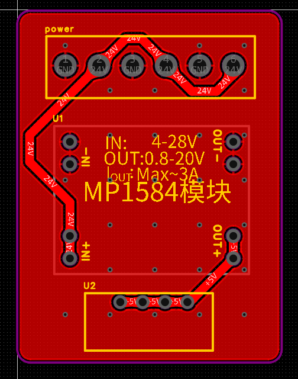

# ESP32 PS2 双电机遥控底盘

PS2 无线手柄通过接收器把摇杆和按键数据送给 ESP32。ESP32 分别控制两块 BTS7960，由它们驱动左、右电机。两轮同向实现前进和后退，两轮输出不同实现转弯，两轮反向实现原地转向。

项目维护者为 [Bofly-007](https://github.com/Bofly-007)。本项目仅供参考和学习，未经维护者事先许可，禁止将本项目的源码、固件、PCB 设计和制板资料或文档用于商业用途或商业谋利。

## 硬件

| 器件 | 数量 | 用途 |
| --- | --- | --- |
| 30 针 ESP32 开发板（CH340 USB 串口） | 1 | 读取手柄、计算左右轮指令、输出 PWM。ESP-IDF 目标为 `esp32` |
| PS2 无线手柄及接收器 | 1 套 | 遥控底盘。接收器由 ESP32 的 3V3 供电 |
| BTS7960 电机驱动板 | 2 | 每块驱动一台电机 |
| 31ZY 有刷直流减速电机 | 2 | 左右轮动力。选用 80 转/分规格，额定电压以实物为准 |
| 24 V 锂电池组 | 1 | 为电机供电。接线前核对电池满电电压与电机、驱动板的允许电压 |
| 电源扩展板与 DC-DC 降压模块 | 1 套 | 将同一块电池的电源分给两块驱动板，并提供 ESP32 和驱动逻辑所需的 5 V。降压模块的输入范围须覆盖电池满电电压 |
| 底盘车轮 | 4 | 左右两个驱动轮（半径约 5 cm），前后各一个万向轮 |

## 接线

下表使用 ESP32 的 **GPIO 编号**，按开发板丝印查找。[board_config.h](main/board_config.h)

### 两块 BTS7960

| 驱动板接口 | 左轮驱动板 | 右轮驱动板 |
| --- | --- | --- |
| RPWM | GPIO25 | GPIO16（也可能标为 RX2） |
| LPWM | GPIO26 | GPIO17（也可能标为 TX2） |
| R_EN | GPIO32 | GPIO22 |
| L_EN | GPIO33 | GPIO27 |
| VCC | 稳压 5 V | 稳压 5 V |
| GND | 公共地 | 公共地 |
| B+ / B− | 电池正极 / 负极 | 电池正极 / 负极 |
| M+ / M− | 左轮电机的两根动力线 | 右轮电机的两根动力线 |
| R_IS / L_IS | 留空 | 留空 |

每块板的 R_EN 和 L_EN 各用一根信号线。若驱动板使用 5 V 供电的 **74HC244**，ESP32 的 3.3 V 高电平可能达不到其输入要求。核对实物后，可用支持 3.3 V 输入的 5 V 单向缓冲器（如 74HCT125）转换每块板的四路控制信号。

### PS2 接收器

| 接收器接口 | ESP32 | 信号方向 |
| --- | --- | --- |
| VCC | 3V3 | ESP32 向接收器供电 |
| GND | GND | 公共地 |
| DAT | GPIO19 | 接收器 → ESP32 |
| CMD | GPIO23 | ESP32 → 接收器 |
| CS / SEL | GPIO21 | ESP32 → 接收器 |
| CLK | GPIO18 | ESP32 → 接收器 |

### 独立供电

项目配有自制电源扩展板。装好匹配的 DC-DC 降压模块后，一块 24 V 锂电池即可同时为两块 BTS7960 和 ESP32 供电。扩展板的制造资料中可确认 `24V`、`+5V` 和 `GND` 三条电源网络。两块驱动板的电机电源使用电池电压，ESP32 和两块驱动板的逻辑电源用同一路稳压 5 V。PWM、EN 和手柄信号按上述引脚表连接。



[下载 Gerber 制板文件](hardware/power-expansion-gerber.zip)。压缩包包含铜层、丝印、阻焊、板框、钻孔和飞针测试数据。

```text
24 V 锂电池 → 电源扩展板
             ├── 电池电压 → 两块 BTS7960 的 B+ / B−（电机电源）
             └── DC-DC 降压 → 稳压 5 V ┬── ESP32 的 5V/VIN 电源入口
                                       └── 两块 BTS7960 的 VCC（逻辑电源输入）

ESP32 的 3V3 ── PS2 接收器 VCC
公共地 ─────── 电池负极、降压模块 GND、ESP32 GND、两块驱动板 GND、接收器 GND
```

首次使用扩展板时，先空载通电，测量 `+5V` 对 `GND` 确认电压和极性，再接 ESP32 和两块驱动板的 VCC。电机供电路径、扩展板走线和接线端子需能承受两台电机同时启动的电流。USB 烧录时，若开发板是否支持 USB 和外部 5 V 同时供电尚未确认，先断开接入 ESP32 的外部 5 V。

预览图标注的 MP1584 模块输入上限为 28 V。若所用 24 V 锂电池为 7 串、每节满充 4.2 V，整包满电可达 29.4 V。选用的降压模块必须覆盖实际电池满电电压。

## 手柄操作

上电默认进入手柄模式，驱动输出关闭。打开手柄，等接收器配对后，让**左摇杆回中**并松开 **L1、叉键（×）**。就绪后，按住 L1 并操作左摇杆。

| 左摇杆动作 | 小车动作 |
| --- | --- |
| ↑ / ↓ | 两轮同向，前进 / 后退 |
| ← / → | 两轮反向，原地左转 / 右转 |
| 斜推 | 左右轮输出不同，边走边转 |
| 松手回中 | 关闭两轮输出 |

松开 L1 或按下叉键也会关闭驱动，两轮靠惯性滑停。叉键停车、重连、切换回手柄模式或摇杆偏离中心时松开 L1 后，先回中并松开按键，再继续操作。

## 控制逻辑和保护

- **差速调速。** 左摇杆纵轴决定前后，横轴决定转向。中心附近设死区。左右轮目标 PWM 各为 −100%～+100%，斜推超限时按相同比例缩小两侧输出。
- **缓启动和换向。** PWM 由硬件以 20 kHz 输出。每轮每 20 ms 向目标调整 1 个百分点，由零升到 100% 约需 2 秒。换向时先降到零并关闭该轮输出，等待至少 500 ms，再向反方向增加输出。
- **指令超时。** 手柄模式连续 200 ms 没有有效数据时关闭两轮输出，恢复后需先回中。串口模式下，有效电机指令 10 秒未更新也会关闭两轮。若接收器在手柄关机后持续发送旧数据，ESP32 可能无法识别无线失联，首次架空时应验证该接收器的表现。
- **开环控制。** 当前未接入编码器反馈或 PID。PWM 百分比代表输出指令，实际轮速受电压、负载和两台电机差异影响。按轮半径 5 cm 和轮轴 80 转/分估算，直行约为 0.42 m/s，实车速度以测量为准。原地转向角度由操作者控制。

## 在 VS Code 中烧录和调试

1. 克隆仓库或下载 ZIP 并解压到任意目录。用 VS Code 打开包含 `CMakeLists.txt` 的项目根目录。安装 Espressif ESP-IDF 扩展并配置 ESP-IDF 5.5.6，这是本项目验证过的版本。选择目标 `esp32` 和 UART 烧录。
2. 用 USB 数据线连接开发板，运行 `ESP-IDF: Select Port to Use`，选择电脑实际识别到的 CH340 串口。Windows 上显示为 `COM` 加端口编号，其他系统按设备列表选择。
3. 运行 `ESP-IDF: Build, Flash and Start a Monitor on Your Device`。监视器波特率为 `115200`。启动后会出现 `motor>` 提示符。
4. 首次将两轮架空，输入 `mode serial`。分别发 `motor 40 0` 和 `motor 0 40`，确认正指令下两轮各自朝车头方向滚动。每次观察后输入 `stop`。当前配置按镜像安装预设左轮 `LEFT_MOTOR_REVERSED=0`、右轮 `RIGHT_MOTOR_REVERSED=1`。若某轮方向相反，可切换该轮的配置值并重新烧录，或断电后对调该电机的两根动力线，任选其一。
5. 输入 `mode ps2`，待摇杆回中并松开 L1 和叉键后，测试前进、后退、左右转向和停车。

| 串口命令 | 作用 |
| --- | --- |
| `status` | 查看控制模式、两轮目标及当前 PWM、故障、接收器数据和手柄就绪状态 |
| `mode serial` / `mode ps2` | 先关闭两轮输出，再切换到串口测试 / 手柄控制 |
| `motor <左轮> [右轮]` | 串口模式下设置左右轮目标 PWM，接受 −100～100 的整数。省略右轮参数时右轮目标为 0 |
| `motor 40 40` / `motor -40 -40` | 两轮分别测试正向 / 反向 |
| `motor 0 0` | 两轮平滑降为零 |
| `stop` | 立即关闭两轮输出，轮子自由滑停 |

如果显示 `Build Successful` 后组合任务仍报错，查看终端的烧录或监视错误，并确认选中的串口仍存在。若出现 `InvalidSetup` 或找不到 CMake，在 ESP-IDF 扩展中重新选择或配置本机环境。项目通过 `sdkconfig.defaults` 提供默认构建配置，安装路径和烧录端口由各自电脑配置。

## 代码结构与验证

| 文件 | 功能 |
| --- | --- |
| `main/board_config.h` | 引脚、左右轮方向设置、PWM 频率 |
| `main/ps2_bus.c` | PS2 通信及模拟摇杆模式配置 |
| `main/ps2_control.c` | 解析按键和摇杆，执行回中保护及差速计算 |
| `main/bts7960.c` | 输出四路 PWM 和四路 EN，分别驱动左右轮 |
| `main/motor_ramp.c` | 单轮输出渐变、换向等待和超时 |
| `main/main.c` | 任务启动、切换控制模式及处理串口命令 |

双轮版本已通过 ESP-IDF 编译，固件位于 `build/motor.bin`。电脑端测试覆盖差速分配、回中、停车、换向和指令超时。实车表现取决于板上烧录的版本和实物接线，轮向、无线失联时的行为以及带载速度需分别以实车检查为准。
